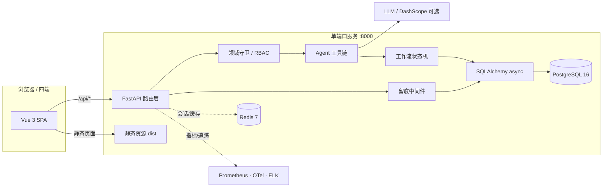

# 架构与数据流

## 总体结构

前端与 API 由同一个 uvicorn 进程提供，部署时只需暴露一个端口，避免跨域与双进程编排。

## 后端模块

| 模块 | 职责 |
|---|---|
| `main.py` | 应用装配、CORS、静态资源托管、Prometheus ASGI、启动建表与种子数据、HTTP 中间件兜底留痕 |
| `config.py` | Pydantic Settings，读取仓库根 `.env` |
| `db.py` / `models.py` | 异步引擎、会话工厂、ORM 模型 |
| `security.py` | JWT 签发校验、bcrypt 口令散列 |
| `rbac.py` / `deps.py` | 角色权限矩阵、初始化种子、依赖注入与鉴权守卫 |
| `domain_guard.py` | 只放行服务器排障类专业问题，其余统一回复固定文案 |
| `llm.py` / `agent.py` | 大模型适配、工具编排；未配置 Key 时降级为规则模式 |
| `workflow.py` | 探测 → 条件 → 并行处置 → 重启的状态机 |
| `routers_*.py` | 认证、对话、管理、运维操作、私聊等路由 |
| `timeutil.py` | 统一 Asia/Shanghai 本地时间，前后端时钟同步 |

## 四端与权限

四种角色：`ADMIN`（管理员）、`ENGINEER`（工程师）、`USER`（普通用户）、`LEADER`（领导）。权限在 `rbac.py` 中以矩阵集中声明，路由通过依赖守卫校验。

- 对话、历史、导出、删除一律按 `user_id` 过滤，跨账号不可见
- `DEMO_MODE` 下已登录用户可通过 `/api/auth/demo-switch` 由服务端重新签发 token 来切换身份，不暴露其他账号口令
- 管理员可查看提问人身份并通过私聊线程双向互动

## 留痕模型

一次动作会同时产生三类记录：

1. **操作台账**（`operation_records`）：谁、在什么时间、对哪个目标做了什么
2. **工作日志**（`work_logs`）：面向人的处理过程描述，四端可见
3. **审计日志**（`audit_logs`）：安全视角的不可篡改式记录

HTTP 中间件会对未显式埋点的写请求做兜底记录，避免「有按钮没留痕」。

## 关键数据流：用户提问

1. 用户在 `USER` 端提交排障问题 → 领域守卫判定是否为专业问题
2. 非专业问题直接返回固定文案；专业问题进入 Agent 工具链
3. Agent 结合模拟/真实数据源生成处置建议，必要时驱动工作流状态机
4. 每次工具调用、服务器操作、日志更新都写入台账、工作日志与审计
5. 管理员端可看到提问人身份并主动发起私聊；领导端可查看全过程与报表
6. 前端通过轮询获取全局动态与未读私聊，时间统一由服务端本地时钟给出

## 时间处理

服务端 `timeutil.now_local()` 固定使用 `Asia/Shanghai (+08:00)`，`/api/meta` 暴露服务器时间，前端 `time.js` 以服务器时间为准做展示，避免容器/系统时区为 UTC 导致显示慢 8 小时。

## 可观测性

`config/` 与 `observability/` 提供 Prometheus 抓取、Logstash 管道、Grafana 数据源与 Nginx 反代的样例配置；后端暴露 `/metrics`，OpenTelemetry 可通过 `OTEL_EXPORTER_OTLP_ENDPOINT` 接入 Jaeger 等后端。这些组件是可选的，不安装不影响主流程。
